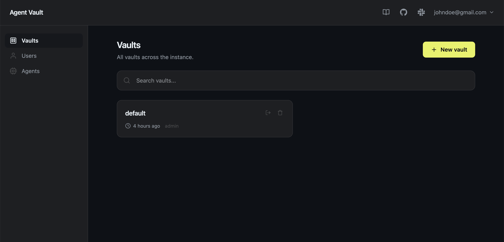
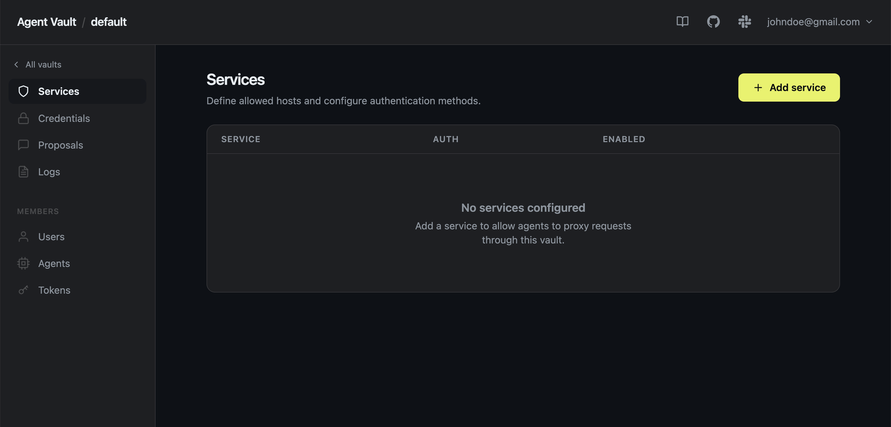
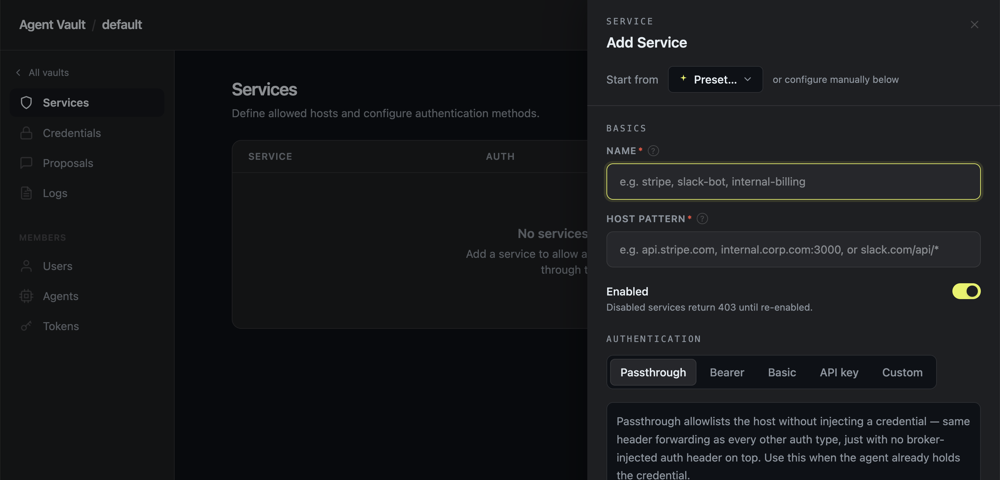
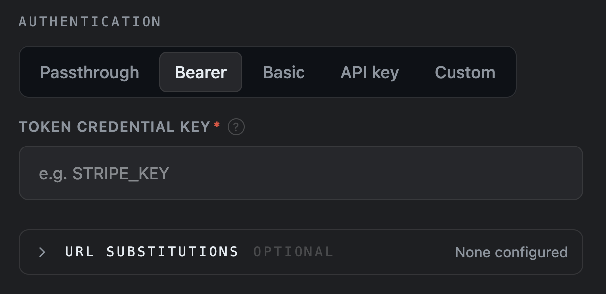
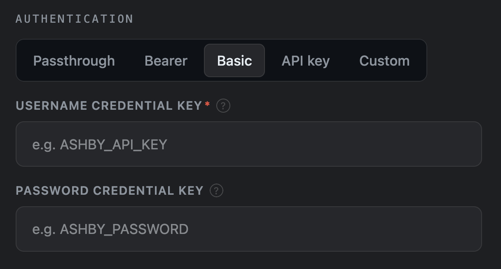
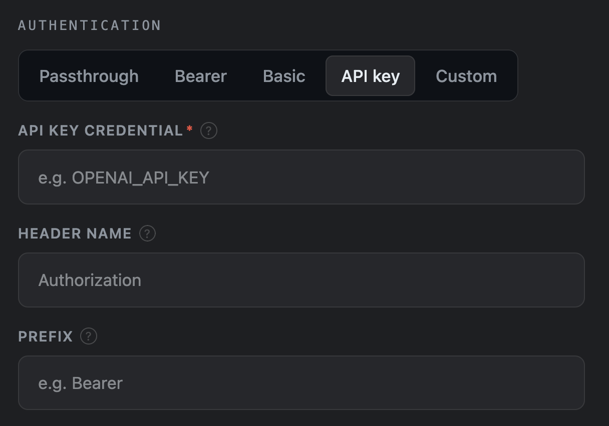
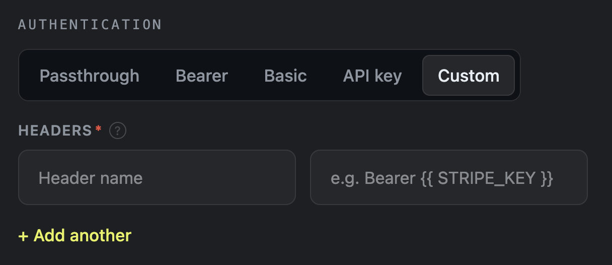
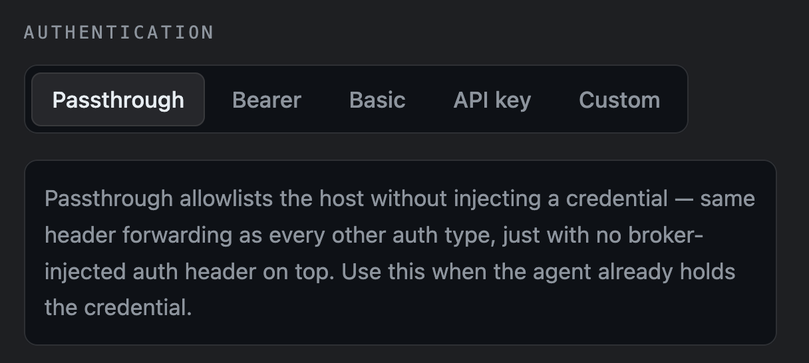
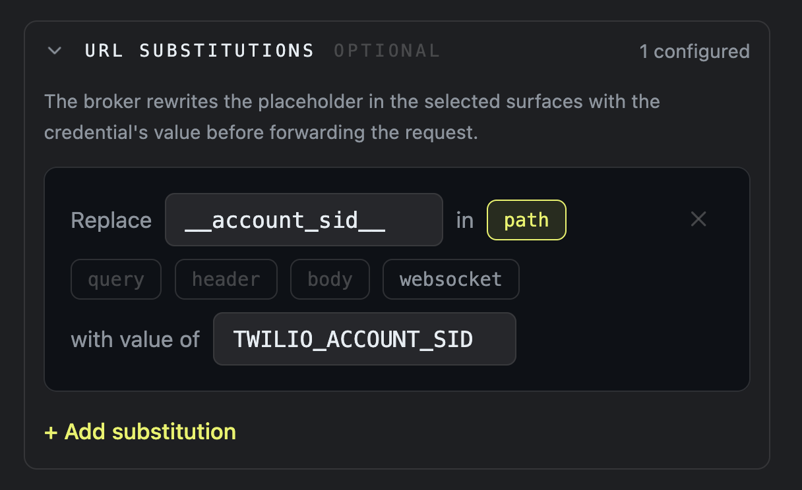
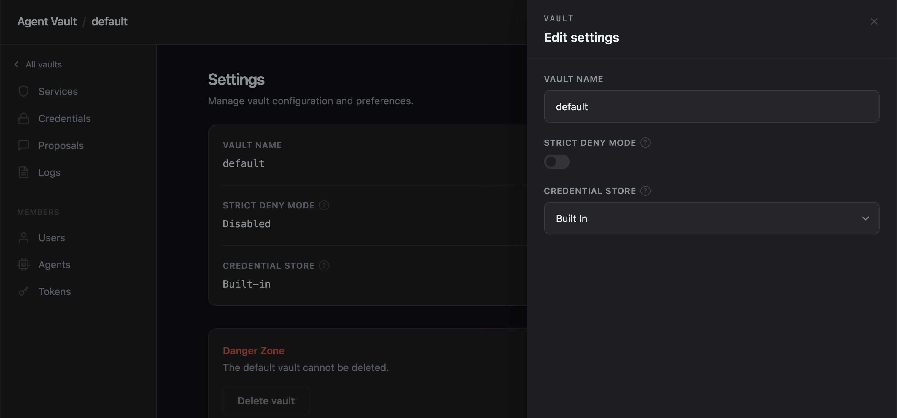

{/* A service defines the terms under which an [agent](/agents/overview) can access a specfic upstream API through the Agent Vault proxy.

Services define which specfic upstream APIs an [agent](/agents/overview) can access through the Agent Vault proxy. It 

A service grants [agents](/agents/overview) access to a specfic upstream API via the Agent Vault proxy. 

A service let you configure how traffic flows from an [agent](/agents/overview) to an upstream API via the Agent Vault proxy. */}

A services is a per-[vault](/learn/vaults) configuration that defines which upstream traffic [agents](/agents/overview) can reach through the proxy and how Agent Vault authenticates to each one.

When an agent makes a proxied request, Agent Vault:

- Matches the request against the vault's services by [host pattern](#host)
- Attaches the configured [credentials](/learn/credentials) according to the service's settings
- Forwards the request to the upstream API

If no service matches, the request is forwarded as plain proxy traffic by default.

<Tip>
An agent proxied through Agent Vault can also raise [proposals](/learn/proposals) to add or modify services.
</Tip>

## Create a service

<Tabs>
  <Tab title="From the UI">
    <Steps>
      <Step>
        Go to your Agent Vault dashboard at `http://<your-host>:14321`:

        <Frame>
        
        </Frame>
      </Step>
      <Step>
        Select the [vault](/learn/vaults) you want to create a service in. This will open the **Services** page:

        <Frame>
        
        </Frame>
      </Step>
      <Step>
       Select **+ Add Service** to open the creation form:

       <Frame>
        
        </Frame>
      </Step>
    </Steps>
  </Tab>
  <Tab title="From YAML">
    You can also create services using YAML files via the [Agent Vault CLI](/reference/cli#services):
    <Steps>
      <Step>
        Create a `.yaml` file with a relevant file name and fill out the required fields. For example:

       ```yaml stripe-services.yaml
        services:
          - name: stripe
            host: api.stripe.com
            auth:
              type: bearer
              token: STRIPE_KEY
        ```

        <Info>
          For a full reference on each possible field when managing services via YAML, check out (placeholder)
        </Info>
      </Step>
      <Step>
        Apply the service via the [`agent-vault vault service set`](/reference/cli#agent-vault-vault-service-set) command:

       
        ```bash
        agent-vault vault service set -f stripe-services.yaml --vault my-vault
        ```
      </Step>
    </Steps>
  </Tab>
</Tabs>

## Configure a service

You can configure a service using the following fields:

### Name

This field defines the vault-scoped identifier for the service. The service's name must be a slug that contains:

- 3-64 lowercase alphanumber/hyphen characters
- No leading/trailing hyphen
- No consecutive hyphens

<Tip>
  You can omit the **Name** field if you specify [host](#host)/path that uniquely matches an existing service.
</Tip>

### Host

This field defines the hostname that Agent Vault will match against when an agent makes a proxied request. You can enter:

- A bare hostname (`api.stripe.com`)
- A one-level wildcard (`*.github.com`, matches `api.github.com`, `uploads.github.com`, etc.)
- An inline path-scoped form (`slack.com/api/*`)
- A port-scoped form (`internal.corp.com:3000` or `internal.corp.com:3000/api/*`)

<Note>
  When you include a port in the **Host** field, the service will only match traffic to that port.
</Note>

<Accordion title="How is matching priority determined?">
When two host patterns could match a request, the winner is chosen deterministically:

1. **Host tier first.** A pattern whose host portion is an **exact match** of the request host always beats one with a **wildcard** host (`*.example.com`) -- even when the wildcard rule has a more specific path or port.
2. **Port specificity.** Within the same host tier, a service with a specific port beats one without a port (any-port wildcard).
3. **Path specificity.** Among rules with the same host tier and port specificity, the rule with the **longest literal path prefix** wins (characters in the path portion before the first `*`). A bare-host pattern (no path) scores 0 (catch-all).
4. **Declaration order on tie.** If two rules tie on all the above, the rule appearing first in the configured service list wins.
</Accordion>

## Authentication types

When configuring a service, you can choose from several authorization types that tell Agent Vault how to authenticate to the target host. You can then give Agent Vault the actual secrets to authenticate with by reference existing [credential](/learn/credentials) key names from the same vault.

Here's a breakdown of each authorization type:

### Bearer

Attaches an `Authorization: Bearer <token>` header. The `token` field references a credential key.

<Tabs>
  <Tab title="UI">
    <Frame>
    
    </Frame>
  </Tab>
  <Tab title="YAML">
  ```yaml
    services:
      - name: api-stripe-com
        host: api.stripe.com
        auth:
          type: bearer
          token: STRIPE_KEY
    ```
  </Tab>
</Tabs>

### Basic

Attaches an `Authorization: Basic <base64>` header using HTTP Basic authentication. The `username` field is required; `password` is optional (defaults to empty).

<Tabs>
  <Tab title="UI">
    <Frame>
    
    </Frame>
  </Tab>
  <Tab title="YAML">
  <CodeGroup>
  ```yaml Without password
    services:
      - name: api-ashbyhq-com
        host: api.ashbyhq.com
        auth:
          type: basic
          username: ASHBY_API_KEY
    ```

    ```yaml With password
    services:
      - name: yoursite-atlassian-net
        host: yoursite.atlassian.net
        auth:
          type: basic
          username: JIRA_EMAIL
          password: JIRA_API_TOKEN
    ```
    </CodeGroup>
  </Tab>
</Tabs>

### API key

Attaches a credential value to a named header with an optional prefix. The `header` field defaults to `Authorization` if omitted.

<Tabs>
  <Tab title="UI">
    <Frame>
    
    </Frame>
  </Tab>
  <Tab title="YAML">
  <CodeGroup>
  ```yaml Without prefix
  services:
    - name: api-anthropic-com
      host: api.anthropic.com
      auth:
        type: api-key
        key: ANTHROPIC_KEY
        header: x-api-key
  ```

    ```yaml With prefix
    services:
      - name: api-example-com
        host: api.example.com
        auth:
          type: api-key
          key: EXAMPLE_KEY
          header: Authorization
          prefix: "ApiKey "
    ```
    </CodeGroup>
  </Tab>
</Tabs>

### Custom

Freeform header templates with `{{ SECRET }}` placeholders. Each placeholder is resolved to the corresponding credential at proxy time.

<Tip>
Use this type when none of the other authentication types are suitable.
</Tip>

<Tabs>
  <Tab title="UI">
    <Frame>
    
    </Frame>
  </Tab>
  <Tab title="YAML">
  ```yaml
  services:
    - name: api-acme-internal
      host: api.acme.internal
      auth:
        type: custom
        headers:
          X-API-Key: "{{ ACME_API_KEY }}"
          X-Tenant-ID: "{{ ACME_TENANT }}"
  ```
  </Tab>
</Tabs>

### Passthrough

Allowlists the host without injecting a credential. No credential is stored, read, or attached; client request headers (including `Authorization` and `Cookie`) flow through to the upstream — same as for credentialed services, just without a broker-injected auth header on top.

<Tabs>
  <Tab title="UI">
    <Frame>
    
    </Frame>
  </Tab>
  <Tab title="YAML">
  ```yaml
  services:
    - name: api-example-com
      host: api.example.com
      auth:
        type: passthrough
  ```
  </Tab>
</Tabs>

Use passthrough when the operator has decided their client already holds the credential (for example, an existing tool that manages its own token) and wants Agent Vault to provide the host allowlist, [netguard](/learn/security), TLS interception, and audit logging without putting the secret in the vault. All the other auth types are the default — reach for passthrough only when you explicitly want Agent Vault *not* to broker the credential.

### Header forwarding

Agent Vault forwards your client's request headers to the upstream unchanged, except for:

- **Hop-by-hop headers** per RFC 7230 (`Connection`, `Keep-Alive`, `Proxy-Authenticate`, `Proxy-Authorization`, `Proxy-Connection`, `Te`, `Trailer`, `Transfer-Encoding`, `Upgrade`).
- **Broker-scoped headers** that authenticate the client to Agent Vault itself (`X-Vault`, `Proxy-Authorization`).
- **The auth slot** — the specific header(s) the configured auth type manages. With `auth.type: bearer` or `basic`, the broker overrides `Authorization`. With `api-key`, it overrides whatever you named in `auth.header`. With `custom`, it overrides every key in `auth.headers`. With `passthrough`, nothing.

This means vendor headers like `anthropic-version`, `OpenAI-Beta`, `If-Match`, and tracing IDs reach the upstream regardless of auth type. The broker only takes over the headers it's responsible for injecting.

<Warning>
  Passthrough auth configs reject every credential field (`token`, `username`,
  `password`, `key`, `header`, `prefix`, `headers`). Setting any of them
  returns a validation error — if you want Agent Vault to inject a credential,
  use one of the credentialed auth types instead.
</Warning>

<Warning>
  Every credential key referenced in an auth config (whether directly or via `
  {{ KEY }}` templates) must resolve to either an existing
  [credential](/learn/credentials) in the vault or a credential slot in the same
  [proposal](/learn/proposals). Agent Vault returns `400` if a key is missing.
  This does not apply to `passthrough` services, which reference no
  credentials.
</Warning>

## Substitutions

Authorization types only inject HTTP headers. Some APIs want a credential value elsewhere, like in the URL path, query string, request body, or even inside a WebSocket message.

To handle these cases, you can add a substitution rule:

<Tabs>
  <Tab title="UI">
    <Frame>
    
    </Frame>
  </Tab>
  <Tab title="YAML">
  ```yaml
  services:
    - name: api-twilio-com
      host: api.twilio.com
      auth:
        type: basic
        username: TWILIO_ACCOUNT_SID
        password: TWILIO_AUTH_TOKEN
      substitutions:
        - key: TWILIO_ACCOUNT_SID
          placeholder: __account_sid__
          in: [path]
  ```
  </Tab>
</Tabs>

With this configuration, the agent sends `GET https://api.twilio.com/2010-04-01/Accounts/__account_sid__/Messages.json` (routed through the broker via `HTTPS_PROXY`/`HTTP_PROXY`).

Then, Agent Vault:

1. Resolves the basic auth credentials and injects `Authorization: Basic <base64(SID:TOKEN)>`.
2. Scans the path, finds `__account_sid__`, and replaces it with the URL-encoded SID.
3. Forwards the request.

### Field reference

- `key` — UPPER_SNAKE_CASE credential reference. Must resolve to a credential in the vault or a slot in the same proposal.
- `placeholder` — the exact wire string Agent Vault matches **case-sensitively** as a literal. Operators choose the string; the broker does not auto-wrap delimiters around it. The recommended convention is `__name__` (double-underscore-bounded snake_case).
- `in` — list of surfaces the broker is allowed to scan. Subset of `path`, `query`, `header`, `body`, `websocket`. Defaults to `[path, query]` if omitted. `header`, `body`, and `websocket` must be explicit.

### Scoping is the security boundary

Agent Vault only scans surfaces listed in `in`. If an agent embeds the placeholder in a non-declared surface, the literal string passes through to upstream — the broker will not substitute. There is no way to coerce the broker into substituting somewhere the operator did not authorize.

Use this property to pick a narrow `in` for strong secrets: keep `in: [query]` and the agent cannot exfiltrate the value through a body, header, or different surface.

### Placeholder safety rules

The validator rejects placeholders that would cause false-positive substitutions in legitimate URL content:

- **Length** ≥ 4 characters.
- **Must contain a `__` sequence or a non-`[A-Za-z0-9_]` character** — so a bare word like `account_sid` is rejected (it could appear as a real path segment), while `__account_sid__`, `sid.value`, `sid-val`, and `~sid~` all pass.
- **At least one alphanumeric character** — strings made entirely of delimiters like `____` or `~~~~` are rejected because they would aggressively match URL punctuation.
- **Only RFC 3986 unreserved characters** `[A-Za-z0-9_-.~]` are permitted, so the placeholder survives any HTTP client / SDK / middlebox without percent-encoding round-trips.

### `header` scope is request-wide

When `in` includes `header`, the broker scans every outbound header for the placeholder — not one specific named header. Pick a unique placeholder so a typo or a copy-pasted value can't accidentally land in a header you didn't intend to rewrite. (Path and query are scoped to those URL components and don't have this concern.)

### `body` scope

When `in` includes `body`, the broker reads the HTTP request body, replaces placeholders, and updates `Content-Length`. Encoding is content-type-aware:

- `application/x-www-form-urlencoded` — the replacement value is URL-encoded (matching `query` surface behavior), so characters like `&`, `=`, and `+` in the credential don't break form parsing.
- `application/json` — the replacement value is JSON-string-escaped, so `"` and `\` in the credential produce valid JSON.
- `multipart/*` — skipped (body returned unmodified). Raw replacement inside multipart boundaries could corrupt binary parts.
- Compressed bodies (`Content-Encoding` set) — skipped.
- All other content types — raw replacement (no encoding).

Use `body` for OAuth `client_secret_post` flows where the secret is sent as a POST form parameter.

### `websocket` scope

When `in` includes `websocket`, the broker scans client→server WebSocket **text frames** for placeholders and replaces them before forwarding to the upstream. Server→client frames are never modified.

Only unfragmented, uncompressed text frames are scanned. Binary frames, control frames (close, ping, pong), fragmented messages, and frames larger than 1 MB pass through unmodified.

When `websocket` is active, the broker strips `Sec-WebSocket-Extensions` from the upgrade handshake to prevent compression negotiation (which would make all frames opaque to the broker).

Use `websocket` for protocols like Discord Gateway where the auth token appears inside a JSON message body (the Identify and Resume events), not in HTTP headers.

### Composes with all auth types

Substitutions and auth are independent. A service can use either, both, or neither:

- Twilio: `auth: basic` (header) + path substitution for the SID.
- Legacy `?api_key=` API: `auth: api-key` for an audit header + query substitution for the actual key.
- A pure-substitution case (e.g. an internal API where the only secret lives in the path): `auth: passthrough` + path substitution.
- Discord Gateway: `auth: passthrough` + header substitution for REST API + websocket substitution for Gateway token injection.
- OAuth `client_secret_post`: `auth: passthrough` + body substitution for the client secret in the token exchange POST.

<Warning>
  Modifying substitutions requires re-supplying auth in the same proposal.
  Auth-only or enable/disable-only `set` proposals preserve existing
  substitutions; to clear them, delete and recreate the service.
</Warning>

## Reject unmatched hosts

You can enable **Strict Deny Mode** to make your vault reject requests from agents to unmatched hosts (hosts which have no associated service). When a proxy request targets a host not covered by any service, Agent Vault will return `403` with a `proposal_hint` in the response body. The hint includes the denied host and the endpoint to create a proposal.

Well-behaved agents use this hint to automatically raise a [proposal](/learn/proposals) requesting access. You receive a browser link to review the request and provide any needed [credentials](/learn/credentials).

To enable **Strict Deny Mode**:

<Steps>
  <Step>
    Go to your Agent Vault dashboard at `http://<your-host>:14321`:

    <Frame>
    
    </Frame>
  </Step>
  <Step>
    Select the [vault](/learn/vaults) whose settings you want to modify:

    <Frame>
    
    </Frame>
  </Step>
  <Step>
    Select **Settings** in the bottom-left corner, then select **Edit settings**:

     <Frame>
    
    </Frame>

    Enable **Strict Deny Mode**, then select **Save**.
  </Step>
</Steps>

Now, when a proxy request targets a host not covered by any service, Agent Vault will return `403` with a `proposal_hint` in the response body. The hint includes the denied host and the endpoint to create a proposal.

Well-behaved agents use this hint to automatically raise a [proposal](/learn/proposals) requesting access. You receive a browser link to review the request and provide any needed [credentials](/learn/credentials).