This guide teaches you how to run OpenCode on Render and use it to create a GitHub issue with an OpenAI API key and GitHub token stored in Agent Vault. The OpenCode worker receives placeholders and never sees your credentials.

<Info>
Prerequisites:

- A [Render account](https://dashboard.render.com/login)
- An OpenAI API key
- A GitHub repository where you can create issues
- A [fine-grained GitHub personal access token](https://docs.github.com/en/authentication/keeping-your-account-and-data-secure/managing-your-personal-access-tokens#creating-a-fine-grained-personal-access-token) with access to that repository and **Issues: Read and write** permission
- A Git repository that Render can use to build the OpenCode worker
</Info>

## Step 1: Deploy Agent Vault

<Steps>
  <Step title="Create a Postgres database">
    In the [Render Dashboard](https://dashboard.render.com), select **New > Postgres** and create a database in the region where Agent Vault and your agents will run:

    <Frame>
      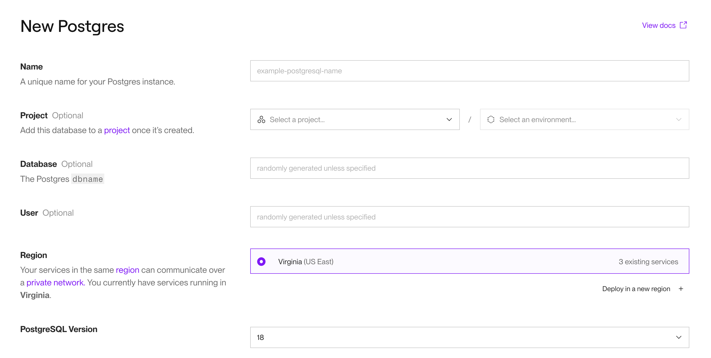
      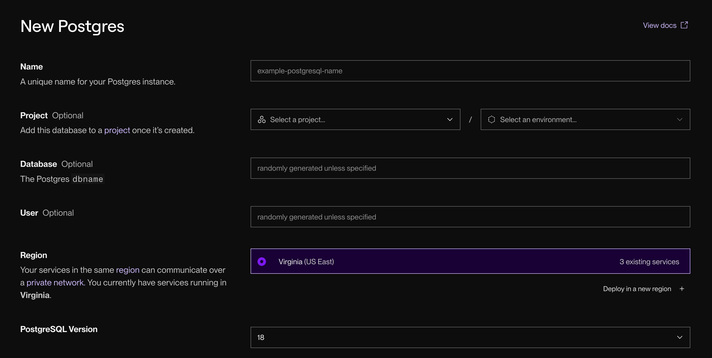
    </Frame>

    When the database is ready, scroll down to **Connections** and copy its **Internal Database URL**. You'll need this when configuring the environment variables for the Agent Vault web service.
  </Step>

  <Step title="Create the Agent Vault service">
    Select **New > Web Service** and choose **Existing Image**. In the **Image URL**, paste in the following:

    ```text
    docker.io/infisical/agent-vault:latest
    ```

    <Frame>
      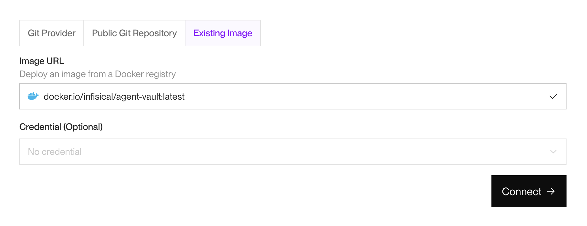
      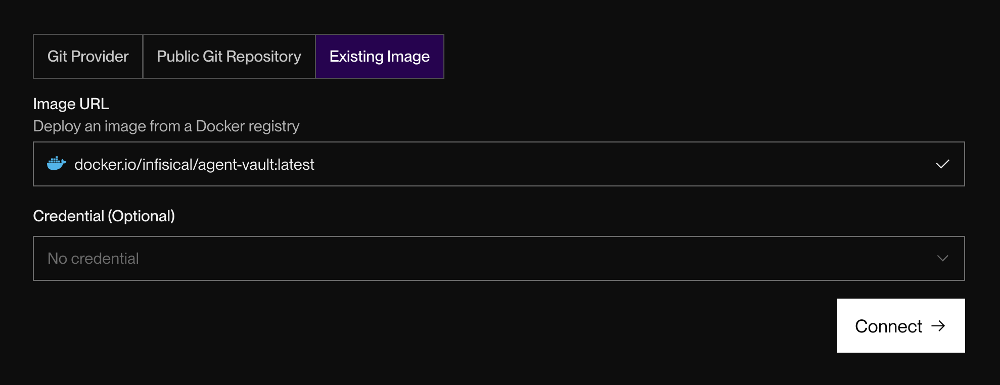
    </Frame>

    Select **Connect**. Then, make sure the selected region is the same as the database you created in the previous step.
    
    Scroll down to **Advanced**, then set the **Health Check Path** to `/health`.
  </Step>

  <Step title="Configure environment variables">
    Scroll to **Environment Variables**. Then, add the following variables to the web service:

    | Variable | Value |
    |----------|-------|
    | `PORT` | `14321` |
    | `DATABASE_URL` | The Postgres internal database URL you copied earlier |
    | `AGENT_VAULT_MASTER_PASSWORD` | A generated master password |
  </Step>

  <Step title="Set the public address">
    After Render assigns the service its `onrender.com` URL, copy it. Then, go to **Environment** and add the URL as another environment variable in the web service:

    ```text
    AGENT_VAULT_ADDR=https://<your-service>.onrender.com
    ```

    Then, select **Save and deploy**. Your environment variable setup should look like this:

    <Frame>
      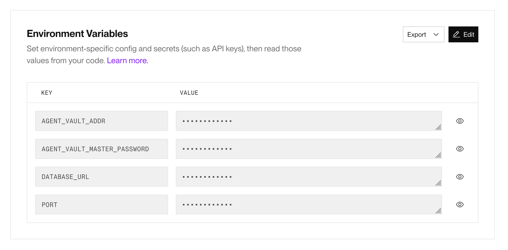
      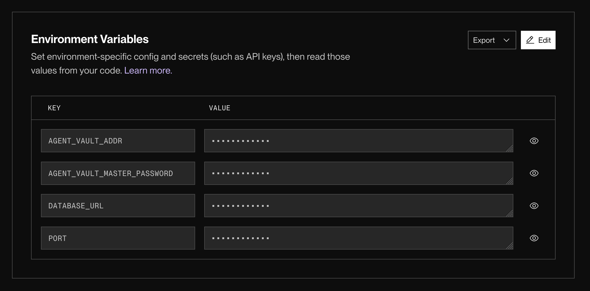
    </Frame>
  </Step>

  <Step title="Register the owner">
    Open `https://your-service.onrender.com/register`. The first user becomes the instance owner and an admin of the default vault.

    Then, check that the service is healthy at `https://your-service.onrender.com/health`.
  </Step>
</Steps>

## Step 2: Store the API credentials

<Steps>
  <Step title="Create a vault">
    Sign in to Agent Vault, open **Vaults**, and create a vault named `render-opencode`.

    <Frame>
    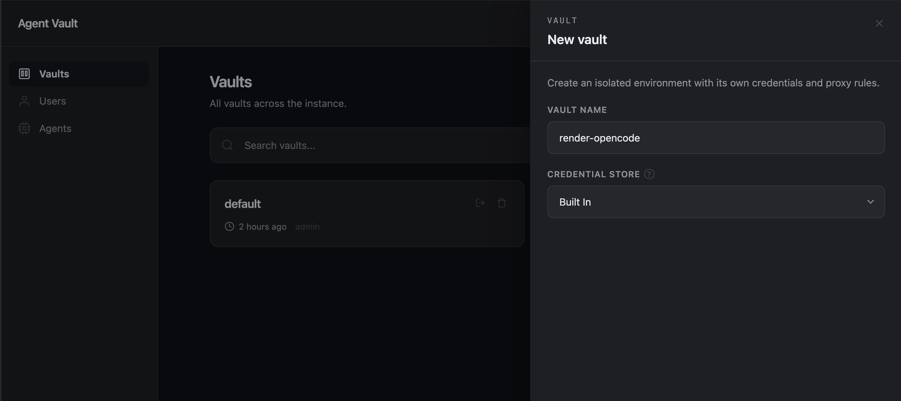
    </Frame>
  </Step>

  <Step title="Add the credentials">
    In the `render-opencode` vault, go to **Credentials** and add both real values:

    | Key | Value |
    |-----|-------|
    | `OPENAI_API_KEY` | Your OpenAI API key |
    | `GITHUB_TOKEN` | Your fine-grained GitHub personal access token |

    These values stay in Agent Vault. Don't add them to Render's OpenCode worker.

    <Note>
    Brokering credential values doesn’t limit what an authorized agent can do with them. Keep your GitHub token restricted to the required repository and permissions, and revoke or rotate the Agent Vault agent token when the worker is no longer needed.
    </Note>
  </Step>

  <Step title="Add the OpenAI service">
    Open **Services**, select **Add service**, and configure:

    | Field | Value |
    |-------|-------|
    | Name | `openai` |
    | Host | `api.openai.com` |
    | Authentication | `Passthrough` |
    | Substitution placeholder | `__openai_api_key__` |
    | Substitution credential | `OPENAI_API_KEY` |
    | Substitution surface | `header` |

  </Step>

  <Step title="Add the GitHub service">
    Add a second service:

    | Field | Value |
    |-------|-------|
    | Name | `github` |
    | Host | `api.github.com` |
    | Authentication | `Passthrough` |
    | Substitution placeholder | `__github_token__` |
    | Substitution credential | `GITHUB_TOKEN` |
    | Substitution surface | `header` |

    The GitHub CLI and OpenCode will both put their placeholder values in their authorization headers. Then, Agent Vault will replace them with the real values before forwarding the request.
  </Step>
</Steps>

## Step 3: Create the agent identity

<Steps>
  <Step>
    In Agent Vault, go to **Agents** > **Add agent**:

    <Frame>
    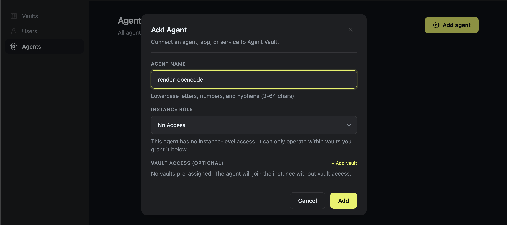
    </Frame>

    Name the agent `render-opencode`.
  </Step>
  <Step>
    Select **+ Add vault**, then grant it the **Proxy** role on the `render-opencode` vault.
  </Step>
  <Step>
    After creating the agent, copy its token. Agent Vault shows it only once.
    
    <Note>
    This token authorizes the worker to use the configured services, but the proxy role can't read credential values.
    </Note>
  </Step>
</Steps>

## Step 4: Build the OpenCode worker

Commit and push these two files to the Git repository Render will build:

```dockerfile Dockerfile
FROM node:22-bookworm-slim

RUN apt-get update \
    && apt-get install -y --no-install-recommends ca-certificates git gh \
    && rm -rf /var/lib/apt/lists/*

RUN npm install -g opencode-ai
COPY --from=infisical/agent-vault:latest /usr/local/bin/agent-vault /usr/local/bin/agent-vault

RUN mkdir -p /workspace && chown node:node /workspace
USER node
WORKDIR /workspace

COPY --chown=node:node opencode.json ./opencode.json

CMD ["sleep", "infinity"]
```

The worker sleeps until you open a Render shell. Its image contains OpenCode, the GitHub CLI, and the Agent Vault CLI, but no credentials.

```json opencode.json
{
  "$schema": "https://opencode.ai/config.json",
  "model": "openai/gpt-5.4-mini",
  "enabled_providers": ["openai"],
  "share": "disabled",
  "autoupdate": false,
  "provider": {
    "openai": {
      "options": {
        "apiKey": "{env:OPENAI_API_KEY}"
      }
    }
  },
  "permission": {
    "edit": "deny",
    "bash": {
      "*": "deny",
      "gh issue create *": "allow"
    }
  }
}
```

<Note>
The broad Bash denial appears first because [OpenCode uses the last matching permission rule](https://opencode.ai/docs/permissions/#granular-rules-object-syntax). This configuration permits only the `gh issue create` command needed by this guide.
</Note>

## Step 5: Deploy the OpenCode worker

<Steps>
  <Step title="Create the worker">
    In Render, select **New > Background Worker** and connect the repository containing the Dockerfile. Choose the Docker runtime and the same region as Agent Vault.
  </Step>

  <Step title="Find Agent Vault's private hostname">
    Open the Agent Vault web service and copy its hostname from **Connect > Internal**. 

    <Warning>
      Don't use the public `onrender.com` URL for the worker. `agent-vault run` also needs to reach the private broker port on the same hostname.
    </Warning>
  </Step>

  <Step title="Configure the worker">
    Add these environment variables:

    | Variable | Value |
    |----------|-------|
    | `AGENT_VAULT_ADDR` | `http://<agent-vault-internal-hostname>:14321` |
    | `AGENT_VAULT_TOKEN` | The `render-opencode` agent token |
    | `AGENT_VAULT_VAULT` | `render-opencode` |
    | `OPENAI_API_KEY` | `__openai_api_key__` |
    | `GH_TOKEN` | `__github_token__` |

    The last two values are inert placeholders. The real OpenAI and GitHub credentials shouldn't appear anywhere in this worker's settings.
  </Step>

  <Step title="Deploy">
    Create the background worker and wait for its deploy to finish.
  </Step>
</Steps>

## Step 6: Create the GitHub issue

Open the worker's **Shell** page in Render and confirm that it has only placeholders:

```bash
printf 'OpenAI: %s\nGitHub: %s\n' "$OPENAI_API_KEY" "$GH_TOKEN"
```

The output should be:

```text
OpenAI: __openai_api_key__
GitHub: __github_token__
```

Run OpenCode through Agent Vault, replacing `OWNER/REPO` with your target repository:

```bash
cd /workspace
agent-vault run -- opencode run \
  'Create a GitHub issue in OWNER/REPO titled "Agent Vault Render test" with the body "Created by OpenCode on Render using credentials brokered by Agent Vault." Use gh issue create and return the issue URL.'
```

OpenCode uses the brokered OpenAI key to process the prompt, then runs `gh issue create` with the brokered GitHub token. It should finish by printing the new issue's URL:

<Frame>
  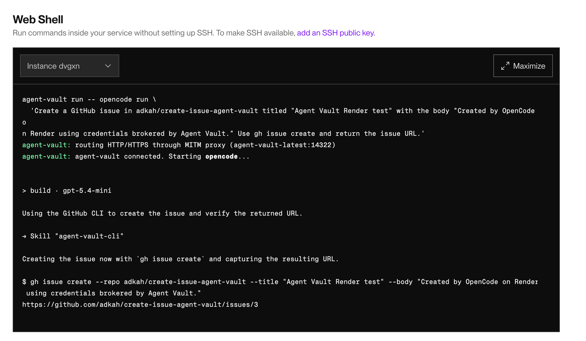
  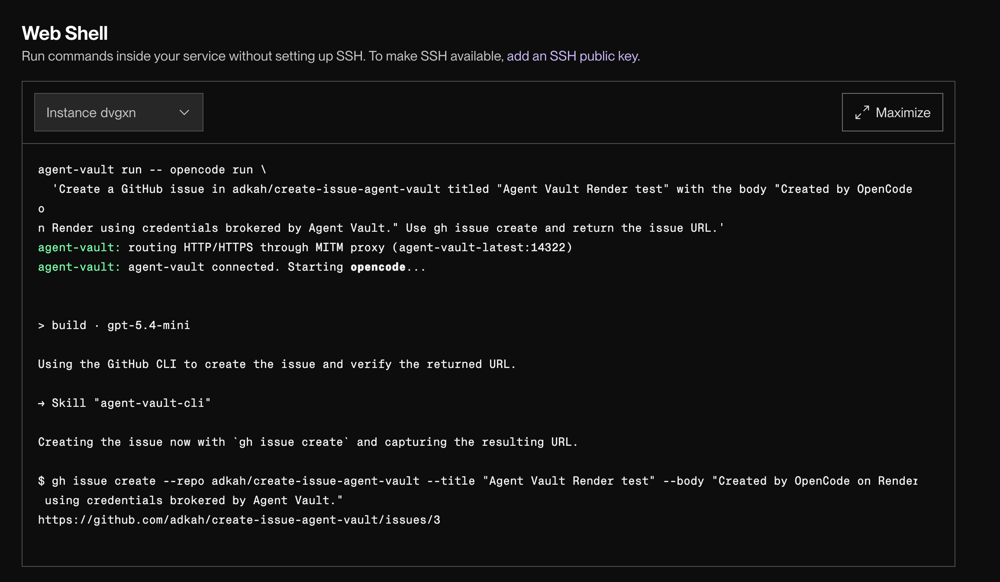
</Frame>

You can verify the result by opening the URL and confirming that the issue exists in GitHub:

<Frame>
  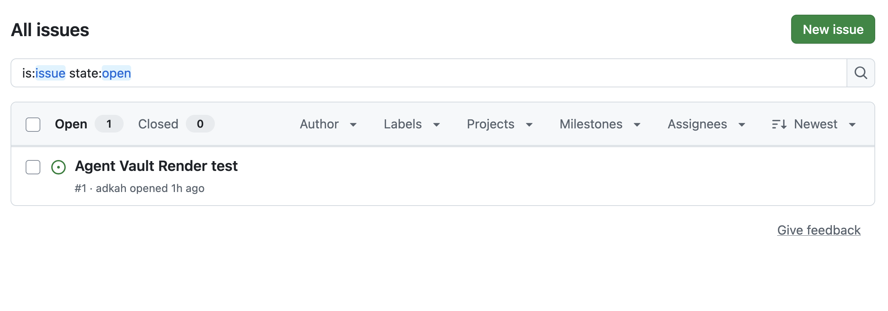
  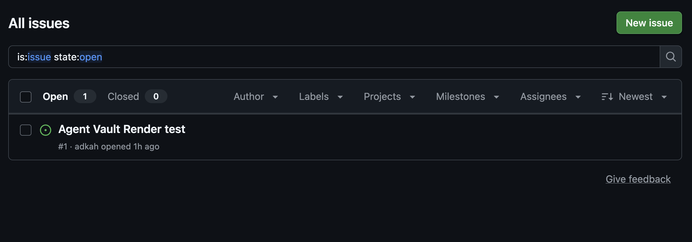
</Frame>

<Check>
  You have deployed Agent Vault and an OpenCode worker on Render, then used brokered OpenAI and GitHub access to create an issue without exposing either vault-stored credential value to OpenCode.
</Check>